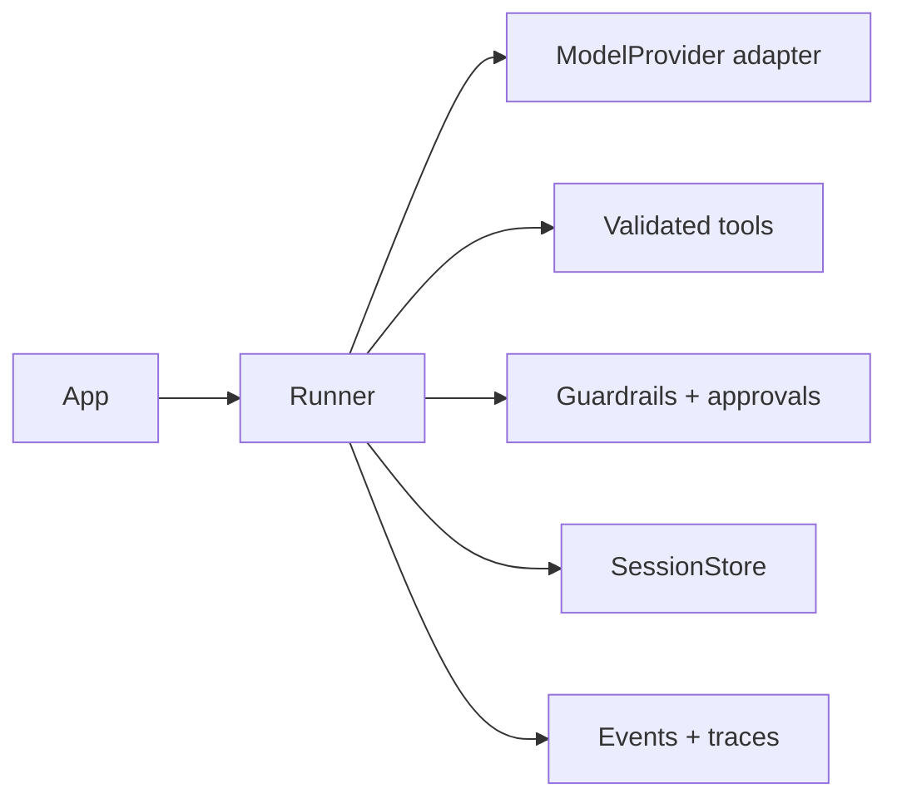

# Agent SDK

> Build reliable, provider-independent AI agents with tools, memory, guardrails, handoffs, streaming, and observable execution.

[](https://github.com/OWNER/REPOSITORY/actions/workflows/ci.yml)

AgentSDK is a compact, open-source TypeScript runtime for agents that must do more than produce text. Its orchestration loop is written from scratch and deliberately visible: model calls, tool validation, approvals, transfers, limits, sessions, and traces have explicit types and behavior. The badge uses a placeholder until this repository has a GitHub remote.

## Why it is useful

- Provider-neutral model boundary with mock-first testing
- Zod-inferred asynchronous tools and structured output
- Auto-reject approval default for risky actions
- Exact turn, tool, handoff, repair, repeat, timeout, and deadline bounds
- Persistent sessions without mutable agent definitions
- Ordered events and dependency-free traces
- No agent framework and no hidden orchestration

## Installation

Packages are not published yet. In this workspace run `pnpm install && pnpm build`. After publication: `pnpm add @vasuagent/core @vasuagent/provider-openai zod`.

## Five-minute quick start

```ts
import { Agent, InMemorySessionStore, MockProvider, Runner } from "@vasuagent/core";
const agent = new Agent({ name: "assistant", instructions: "Answer clearly.", model: { provider: new MockProvider({ text: "Hello!" }), model: "mock" } });
const result = await new Runner({ sessionStore: new InMemorySessionStore() }).run(agent, { input: "Hello", sessionId: "demo" });
if (result.status === "completed") console.log(result.output);
```

## Typed tool

```ts
const weather = defineTool({ name: "get_weather", description: "Get current weather", inputSchema: z.object({ city: z.string().min(1) }), outputSchema: z.object({ city: z.string(), temperatureC: z.number() }), idempotent: true, retries: 2, execute: async ({ city }) => ({ city, temperatureC: 28 }) });
```

Declare handoffs with `defineHandoff({ target, description, inputSchema })`; undeclared or cyclic transfers fail safely. Consume live execution with `for await (const event of runner.stream(agent, input))`.

## Architecture



| Capability | Status |
|---|---|
| Iterative agent/tool loop | Implemented |
| In-memory and atomic file sessions | Implemented |
| Structured output repair | Implemented |
| Transfer handoffs and cycle detection | Implemented |
| Ordered events and trace exporters | Implemented |
| Mock and OpenAI providers | Implemented |
| Delegation / SQLite / native runtime token streaming | Planned |

## Documentation and demo

- Documentation: `pnpm docs:dev` (hosted URL not configured)
- Playground: `pnpm dev` (deployed demo not configured)
- npm: publication not performed

Unknown tools never execute; high-risk tools never auto-approve; work and memory are bounded; secrets are redacted from safe error/trace paths. Regex guardrails are heuristics, not a security boundary. Applications must implement authorization and tool allowlists.

This is an early open-source release candidate. See the [guide](docs/guide.md), [roadmap](docs/guide.md#roadmap), [ADRs](docs/architecture/README.md), [contributing guide](CONTRIBUTING.md), [security policy](SECURITY.md), and [MIT license](LICENSE). Thanks to the TypeScript, Zod, Vitest, VitePress, Biome, and tsup communities.
