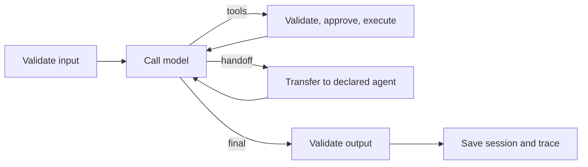
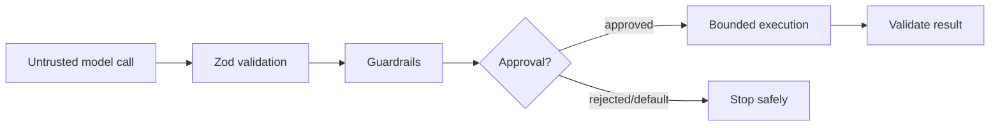
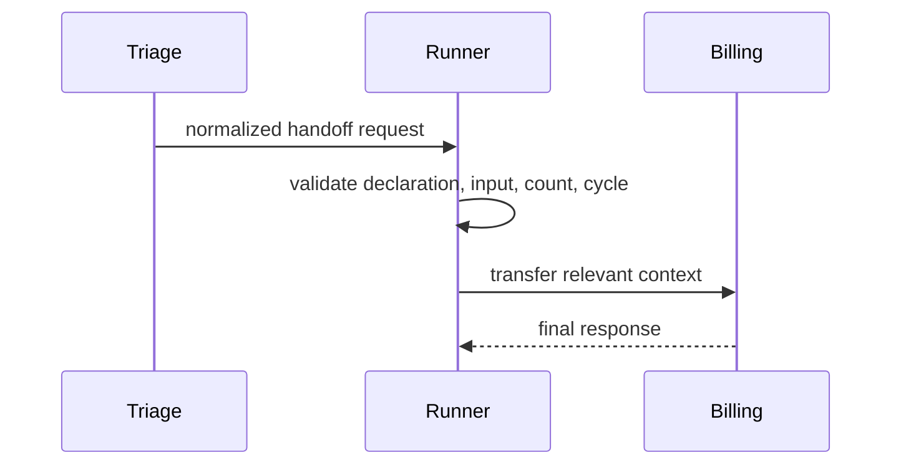
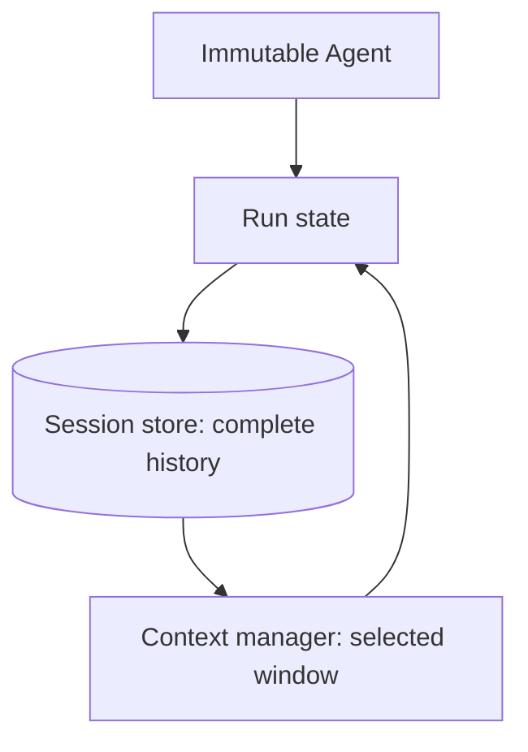

# Introduction

VasuAgent is a small TypeScript SDK for agents that call tools and business systems without hiding the execution loop.

## Why VasuAgent exists

Low-level model APIs omit orchestration; large frameworks can obscure it. VasuAgent makes state, limits, approvals, events, and traces explicit.

## Installation

```bash
pnpm add @vasuagent/core @vasuagent/provider-openai zod
```

Packages are source-ready but not yet published; see Deployment.

## Five-minute quick start

```ts
import { Agent, MockProvider, Runner } from "@vasuagent/core";

const agent = new Agent({
  name: "assistant",
  instructions: "Answer clearly.",
  model: { provider: new MockProvider({ text: "Hello!" }), model: "mock" },
});
const result = await new Runner().run(agent, { input: "Hello" });
```

## Core concepts

Agent configuration is immutable, run state is ephemeral, and session state is persistent. These lifecycles are deliberately separate.

## Agents

An `Agent` owns instructions, model configuration, tools, declared handoffs, guardrails, optional output schema, and bounded limits. It does not contain conversation history.

## Runner and agent loop



The loop is iterative, never recursively self-invoked, and enforces exact turn, tool, handoff, repeated-action, and deadline limits.

## Model providers

`ModelProvider` normalizes messages, calls, output, usage, streaming, cancellation, and errors. `MockProvider` is deterministic; `OpenAIProvider` lives in a separate package.

## Custom tools

```ts
const weather = defineTool({
  name: "weather",
  description: "Get weather",
  inputSchema: z.object({ city: z.string().min(1) }),
  outputSchema: z.object({ temperatureC: z.number() }),
  idempotent: true,
  retries: 2,
  execute: async ({ city }, context) => ({ temperatureC: city ? 28 : 0 }),
});
```

## Tool safety



Unknown tools never run. Non-idempotent tools are not automatically retried. Applications still need tool allowlists and authorization.

## Handoffs



Only declared transfer targets are permitted. A visited-agent path detects cycles.

## Guardrails

Guardrails allow, transform, reject, or request approval. Built-ins include input limits, heuristic prompt-injection warnings, secret/PII redaction, blocked command patterns, and monetary limits. Regex checks reduce risk; they do not guarantee security.

## Human approval

`AutoRejectApprovalHandler` is the safe default. Callback and console handlers support approved, rejected, modified, and timed-out decisions. Modified arguments are revalidated.

## Memory and sessions



`InMemorySessionStore` and atomic `FileSessionStore` implement isolation, versioning, TTL, and message bounds. Context selection does not delete persistent history.

## Structured output

Agent schemas infer return types. JSON and fenced JSON are extracted, Zod validates fields, and validation feedback is sent through a strictly bounded repair loop.

## Streaming and events

`runner.stream()` returns ordered events with ID, run ID, timestamp, and sequence. Consumers always receive `run_completed`, `run_failed`, or `run_cancelled`.

## Reliability and fallback

Deadlines compose with external cancellation. Tools have timeouts and idempotency-aware retries. `withFallback()` changes provider only for normalized retryable errors.

## Tracing

Traces contain model and tool spans, usage, status, timing, and safe error data. Exporters support memory, console, and JSON files. Payload capture is off by default.

## Error handling

Results are discriminated unions. `AgentError` subtypes expose stable codes, retryability, safe details, and secret-redacted `toJSON()` output.

## Security

Never pass provider keys to browser code. Treat tool arguments as hostile, authorize every action in application code, bound all work, and review persisted data. Prompt injection remains an open application-level threat.

## API reference

Public exports are documented with generated declaration files. Run `pnpm build`; TypeDoc integration is planned before npm publication.

## Examples

Seven examples live in `examples/`: basic, tools, structured output, streaming, handoffs, persistent memory, and approval. Each has a README and root command.

## Provider adapter guide

Implement `ModelProvider.generate`, translate only at the package boundary, propagate `AbortSignal`, normalize tool calls and usage, and convert service errors to safe SDK errors. Add mocked HTTP tests and an opt-in live smoke test.

## Session-store adapter guide

Implement create/get/append/update/save/delete/list. Preserve isolation, timestamps and versions; use transactions or optimistic concurrency and define corruption/TTL behavior.

## Deployment

Build with `pnpm build`. Publish only through reviewed Changesets with npm provenance and configured secrets. No package or docs URL exists yet.

## Troubleshooting

- Missing OpenAI key: set `OPENAI_API_KEY` server-side.
- A risky tool does not run: configure an approval handler.
- A run stops early: inspect `result.error.code`, events, and trace.
- Native Windows install issues: use Node 20–22 LTS and pnpm 10.

## Limitations

Transfer handoffs are implemented; delegation mode and SQLite are not. Tool execution is sequential in the current release. The OpenAI streaming adapter emits text deltas but final aggregation is performed by non-streaming runtime calls. Regex guardrails are heuristics.

## Roadmap

Parallel-safe tool scheduling, native runtime model streaming, SQLite storage, delegation mode, broader provider packages, OpenTelemetry export, evaluations, and a hosted playground are candidates—not commitments.
